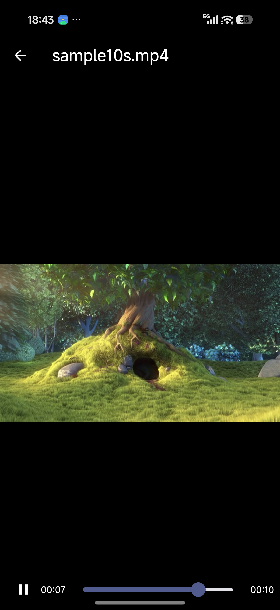

# Reex Player（clean-room rewrite）

Reex 1.8.9 的开源重写版：一个可长期维护的 Flutter + libmpv 播放器。

> 逆向分析与安全审计见 [whyD9527/reex](https://github.com/whyD9527/reex)；
> 本项目只复用**结论**（协议、数据结构、mpv 用法），不包含任何反编译代码。



## 当前状态

- [x] Flutter 工程骨架（Riverpod + Material 3 + 深色/浅色）
- [x] libmpv 播放（media_kit 封装）——**debug 与 release 均已在真机验证**：640×360 / 30fps H.264 正常解码播放
- [x] 系统播放器入口（VIEW/SEND intent → 自动打开播放页）
- [x] SAF 选片（MainActivity 自实现，复制到 cache 后播放）
- [x] 最近打开记录（SharedPreferences）
- [ ] 媒体库（MediaStore 扫描 + 缩略图）
- [ ] SMB / WebDAV / FTP
- [ ] 播放列表 / 历史 / 收藏（可导入 `reex.sqlite`，schema 见 RE 仓库 `data/reex-schema.sql`）
- [ ] 字幕、音轨切换、倍速、画中画

## 架构

```
lib/
├── main.dart                     MediaKit 初始化 + ProviderScope
├── app.dart                      MaterialApp / 主题
├── data/recent_store.dart        最近记录（后续换 drift）
├── platform/intent_channel.dart  reex_player/intent 通道（选片 / 外部 URI）
└── features/
    ├── library/home_page.dart    首页
    ├── player/player_page.dart   libmpv + 控制条
    └── settings/settings_page.dart
android/app/src/main/kotlin/.../MainActivity.kt
    方法通道：getInitialUri / pickVideo / onNewUri
```

## 构建

> ⚠️ **工程路径必须是 ASCII**：AGP 会拒绝 `D:\代码\...` 这类含中文的路径。

```bash
flutter pub get
flutter build apk --debug      # 或 --release
```

本机验证过的工具链：Flutter 3.47.8 / Dart 3.x、AGP 9.1.0、Gradle 9.3.1、
Android SDK 36、JDK 21、NDK r28c。

### 已知的构建坑（已在仓库里处理）

1. **Gradle 发行包**：`android/gradle/wrapper/gradle-wrapper.properties` 默认指向
   services.gradle.org，国内可能被重定向卡住；可改为本地 `file:///` 或镜像。
2. **media_kit 的 libmpv jar 来自 GitHub Releases**：无法访问 GitHub 时，
   把 4 个 `default-*.jar` 预置到
   `build/media_kit_libs_android_video/v1.1.7/`（插件会校验 MD5 后跳过下载）。
3. **AGP 9 的内置 Kotlin 与插件自带的 KGP 冲突**：
   `file_picker` / `package_info_plus` / `wakelock_plus` 在本环境下无法编译，
   已改为：SAF 自实现选片 + `third_party/` 里两个纯 Dart stub。

## 产物

- `flutter build apk --release` → 86 MB（全 ABI）；`--split-per-abi` 可缩到 arm64 单包约 30 MB
- release 目前用 debug 签名（Flutter 模板默认），正式发布请换自己的 keystore

## License

MIT（本仓库自写代码）。第三方依赖遵循各自许可证。